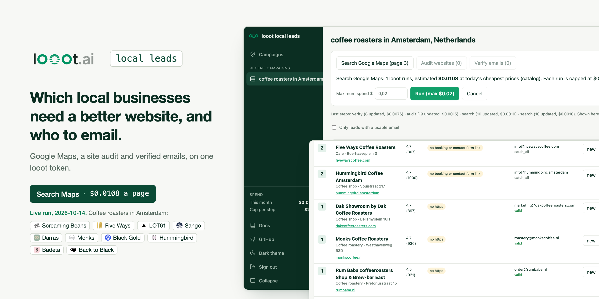
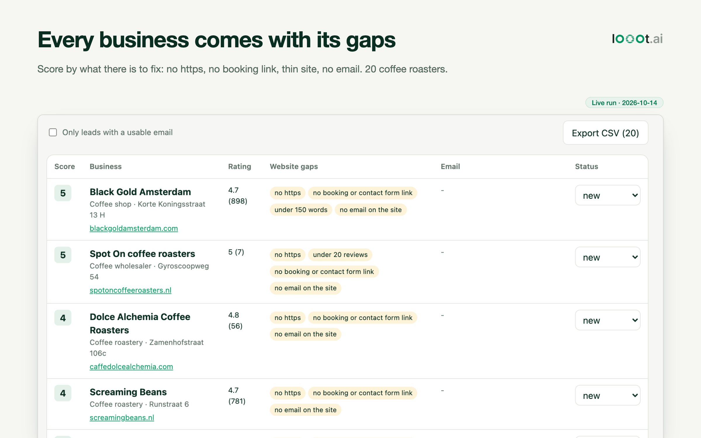
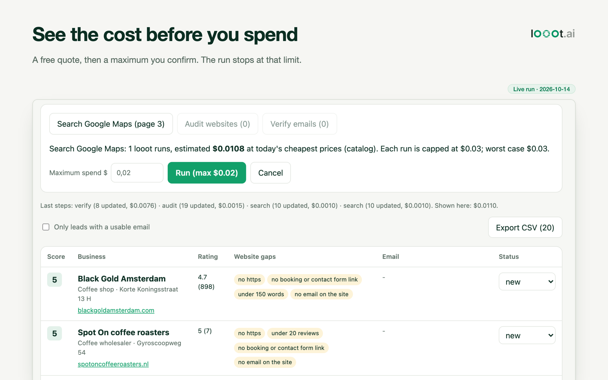
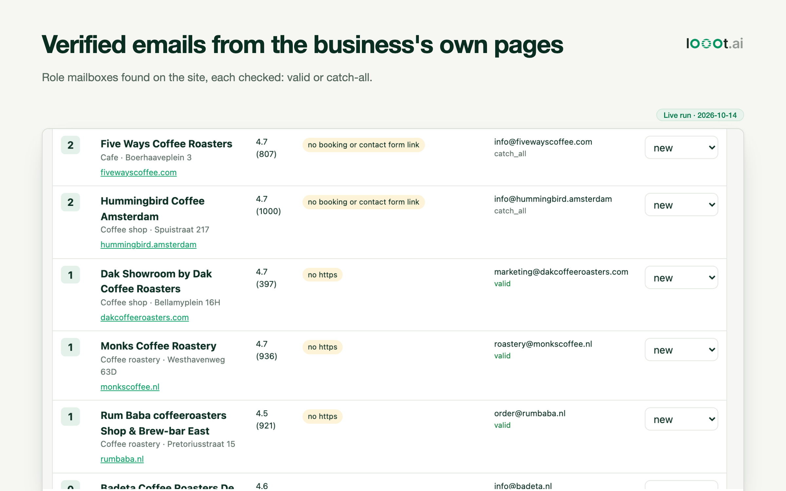
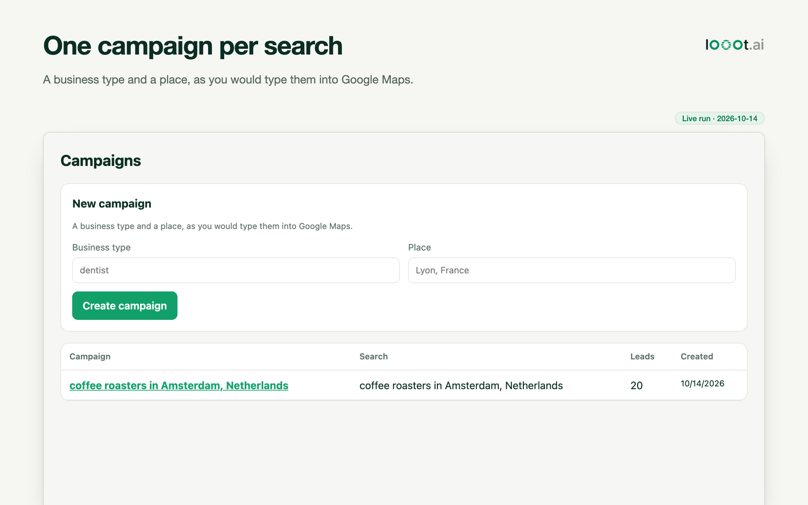
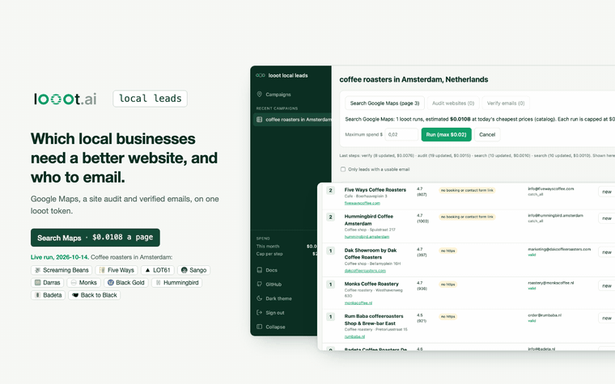

<sub>Logos and names belong to their owners. Public data from a live run on 2026-10-14. No affiliation.</sub>

# looot local leads

[](LICENSE) [](https://github.com/loootai/looot-local-leads/releases) [](https://docs.looot.ai)

[](https://vercel.com/new/clone?repository-url=https%3A%2F%2Fgithub.com%2Floootai%2Flooot-local-leads&env=NEXT_PUBLIC_SUPABASE_URL,NEXT_PUBLIC_SUPABASE_ANON_KEY,LOOOT_TOKEN&envDescription=Supabase%20project%20URL%20and%20anon%20key%2C%20plus%20a%20looot%20agent%20token&envLink=https%3A%2F%2Fgithub.com%2Floootai%2Flooot-local-leads%23set-up&project-name=looot-local-leads&repository-name=looot-local-leads)

<table>
<tr>
<td width="50%"></td>
<td width="50%"></td>
</tr>
<tr>
<td></td>
<td></td>
</tr>
</table>

The banner, the cards and the walkthrough are real screens of the app after a live paid run on 2026-10-14 (see [Live run](#live-run-coffee-roasters-in-amsterdam)). They say "Live run · 2026-10-14". The app ran against a small local stand-in for Supabase (sign-in and two tables, no Docker), so the account is a test account. Business names are public. Only role mailboxes (info@, order@) appear, no personal emails or phone numbers.



The same walkthrough as MP4: [docs/media/demo.mp4](docs/media/demo.mp4).


Open-source prospecting for web, SEO and marketing agencies. Type a business and a place ("dentist", "Lyon, France"), get every business Google Maps lists, see which ones have no website, a site that did not load, no booking link, an old copyright line, a low rating or few reviews, and get a verified public email for the ones worth pitching. Leads are scored by how much there is to fix, and you track each one from `new` to `won`.

It runs on Next.js and Supabase (auth and Postgres), deploys to Vercel, and gets its data from [looot](https://looot.ai): one key and one prepaid balance for 2,500+ data API endpoints. A campaign of 20 businesses costs about $0.06 from search to verified emails. No seat price.

## Live run: coffee roasters in Amsterdam

One campaign on 2026-10-14: "coffee roasters" in "Amsterdam, Netherlands", two Maps pages, one audit, one email check.

| Step | Calls | Charged |
|---|---|---|
| Search Maps (2 pages) | 2 | $0.0020 |
| Audit 19 websites (contact page when the homepage has no email) | 21 | $0.0015 |
| Verify 8 emails | 8 | $0.0076 |
| Total | 31 | $0.0111 |

Before this run I spent about $0.0084 more on 4 test searches and one audit pass that read the pages wrongly, while finding the two bugs below (about $0.0195 in all). The quote said $0.0108 for a Maps page and the real charge was $0.001, because the quote uses the per-result price of a different provider than the one looot picked.

What came out of it:

- 20 businesses, 19 with a website. One (KOF Amsterdam Coffee Roasters) has no website, which is a real lead for a web agency.
- The audit found gaps on 17 sites. Most common: no booking or contact link, no email on the site, no https. Two sites scored 0 (Badeta, Sango).
- 8 role mailboxes were found on the business's own pages. 5 came back valid and 3 catch-all (the same Five Ways address appears for two shops).
- 11 of 19 sites showed "no email on the site". The audit reads markdown, so a contact form or an email loaded by JavaScript is missed.

Two bugs showed up against real answers and are fixed in this change:

- The Maps job needs `q` in the input. Without it looot's cheapest-first routing picked DataForSEO Local Finder, which returns no website for any business, so the app would have flagged every business as "no website". With `q`, Serper answers: 10 places with websites for $0.001.
- looot returns the page markdown and the email status under `normalized.fields`. The app read `normalized.markdown`, so every audited site came back "site did not load". Both are read now, with tests.

One more thing to know. The location is passed through as typed. `Amsterdam, Netherlands` works with Serper. A DataForSEO answer wants `Amsterdam,North Holland,Netherlands` and refuses the short form (that call was free).

## The three steps

| Step | looot job | Runs | Price used for the quote (2026-10-08) |
|---|---|---|---|
| Search Google Maps | `job:maps.local.search` with `query`, `location` (and `page` for more) | 1 per page of about 20 places | $0.0108 (cheapest $0.000539 per result x 20) |
| Audit websites | `job:web.scrape.markdown` on the homepage, then the contact page when the homepage shows no email | up to 2 per site | $0.001 per page |
| Verify emails | `job:people.email.verify` | 1 per email found | $0.00145 |

Prices come from the free public catalog (`GET https://api.looot.ai/v1/catalog/overview?depth=jobs`), cached for an hour, with the prices above as a fallback. Each run uses `fallback` so looot tries the next provider when one misses.

What the audit flags, and the weight each adds to the score:

| Gap | Weight | From |
|---|---|---|
| no website | 3 | Maps listing |
| site did not load | 3 | page read |
| copyright year more than 2 years old | 2 | page read |
| no booking or appointment link | 2 | page read |
| no https | 1 | Maps listing |
| no email on the site | 1 | page read |
| under 150 words on the homepage | 1 | page read |
| rating under 4.0 | 1 | Maps listing |
| under 20 reviews | 1 | Maps listing |

Emails come only from the business's own pages, own-domain addresses first. Nothing is guessed.

## Spending rules

1. Every step starts with a free quote (`/api/campaigns/<id>/quote?step=`): run count and estimate.
2. The user confirms a maximum spend. The run route refuses (HTTP 409) before any paid call when the estimate is above it.
3. Every run is capped with `fallback.maxCostUsd` (`PER_RUN_CAP_USD`, default $0.03). Before each run the cap is lowered to what is left of the maximum, and the step stops when the next run no longer fits. The total cannot pass the confirmed maximum.
4. `MAX_STEP_COST_USD` (default $2) caps any single step on the server.
5. Idempotency keys carry the lead and the step, so running a step again never pays twice for the same page or email.

`LOOOT_TOKEN` is read only in route handlers. It never reaches the browser: the build was checked with a canary token and `grep -r` over `.next/static` finds nothing.

## Set up

You need a Supabase project, a looot agent token, and Node 20 or newer.

1. Create a Supabase project. In Project Settings, API, copy the project URL and the anon key.
2. Apply the schema, from a clone of this repo:

   ```bash
   npx supabase@2.118.0 login
   npx supabase@2.118.0 link --project-ref <your-project-ref>
   npx supabase@2.118.0 db push
   ```

   Or paste `supabase/migrations/20261008000000_init.sql` into the SQL editor and run it.
3. Create a looot agent token at https://looot.ai/settings with `catalog.read`, `runs.read` and `runs.execute`, and top up from $5.
4. Copy `.env.example` to `.env.local`, fill in the three values, then:

   ```bash
   npm ci
   npm run dev
   ```

5. Deploy: click the Vercel button above, or import the repo in Vercel and set the same three variables.

Every user signs in with email and password (Supabase Auth) and sees only their own campaigns and leads: row level security on every table, `owner_id = auth.uid()`, and a lead can only point at a campaign its owner owns.

## Tests

```bash
npm test            # vitest, looot mocked: 33 tests
npm run typecheck   # tsc --noEmit
npm run test:rls    # needs initdb/pg_ctl/psql: applies the migration to a throwaway Postgres and checks RLS
npm run build
```

Covered: reading places from several provider shapes, the website checks, email extraction and the contact page follow-up, scoring, verification status mapping, CSV export with formula escaping, and the spend guard (refuse above the maximum, never pass it while running).

## Limits

- Provider answers differ. `src/lib/places.ts` reads the common Google Maps shapes (Serper, SerpApi, Places API style). A shape it misses gives zero leads, not wrong ones.
- The audit reads markdown, not the rendered page. A booking widget loaded by JavaScript can be missed, so `no booking` is a lead for a call, not a verdict.
- Tested with mocked looot (33 tests) and with one live looot run (above) against a local stand-in for Supabase. A real Supabase project was not used, so start with one small campaign.
- Cold email rules differ by country (consent rules in the EU, for example). Check yours before you send.

## Layout

```
src/lib/steps.ts        search, audit, verify; quote and spend guard
src/lib/places.ts       read places from Maps answers
src/lib/audit.ts        website gaps, emails, score
src/lib/looot.ts        looot client: run job:<id> with fallback and a cost cap, poll the run
src/app/api/campaigns   free quote and paid run per step
supabase/migrations     schema and row level security
```

## License

MIT. See [LICENSE](LICENSE). Built by [looot](https://looot.ai).
